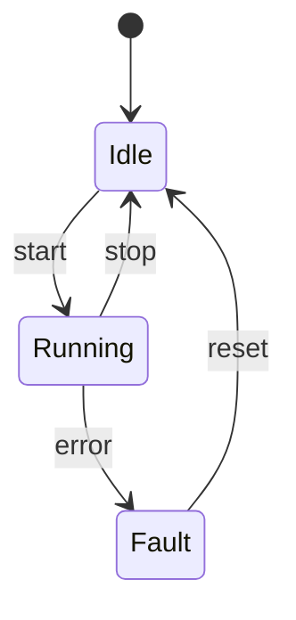

# riscv_asm_lib

A Rust library for assembling RISC-V assembly source into ELF outputs and for building small firmware, runtime, and linker-oriented projects from both single-file and multi-file assembly layouts.

This crate is designed around a practical, project-focused assembler workflow: parse instructions, expand pseudo-ops, apply linker data, and emit either executables or shared objects. It is also used as a code-generation back end for state-machine and data-driven project setups.

This project uses a diagram-to-code workflow and depends on [rust_macro_internal](https://github.com/NomoLynx/rust_macro_internal) during the build. If you want to inspect the project diagrams, install a Markdown/Mermaid previewer in your editor (for example VS Code).

## Latest status

The current codebase includes the following updates and fixes:

- **2026-10-25**: README and API docs refreshed to reflect the shipping feature set: multi-file builds, `INI` and Markdown-driven data integration, Mermaid state-machine generation, bit-manip support, and shared-library output.
- **2026-10-07**: Added Mermaid-driven state-machine code generation from a `stateDiagram-v2` input.
- **2026-10-03**: Added INI-driven multi-source project builds via `ASMSolution`, with relative path resolution from the INI folder and compatibility with the original single-file assembler APIs.
- **2026-03-29**: Added RV64 `Zbb` word-form support (`clzw`, `ctzw`, `cpopw`, `rolw`, `rorw`, `roriw`).
- **Recent bug fixes**: improved multi-file path handling, data-file discovery, dynamic/shared-library output behavior, and symbol/linking edge cases that affected larger assembly projects.

---

## What this library can do

- Parse and validate RISC-V assembly text using a Pest grammar.
- Emit ELF binaries for executables and shared libraries.
- Expand pseudo-instructions into real instructions during a second-round pass.
- Support multi-file assembly projects through `ASMSolution` and INI configuration.
- Read Markdown data tables into `.data` sections with `.data.md` helpers.
- Generate assembly from Mermaid state diagrams.
- Support `Zba`, `Zbb`, `Zbs`, `F`, `D`, and main integer/CSR instruction families.
- Expose a C-friendly crate interface for embedding from native tooling.

---

## Quick start

### Build the crate

```bash
cd CLR/riscv_asm_lib
cargo build
```

### Parse a simple assembly fragment

```rust
use riscv_asm_lib::r5asm::assembler::parse_asm_use_default_config;

let src = r#"
.text
.global _start
_start:
    addi a0, zero, 42
    ecall
"#;

let program = parse_asm_use_default_config(src).expect("assembly failed");
```

### Parse with custom configuration

```rust
use riscv_asm_lib::r5asm::{
    assembler::parse_asm,
    code_gen_config::CodeGenConfiguration,
};

let mut config = CodeGenConfiguration::default();
config.reset_replace_pseudo_code();
config.reset_generate_bin_and_code();

let src = r#"
.text
.global _start
_start:
    li a0, 42
    ecall
"#;

let program = parse_asm(src, &mut config).expect("assembly failed");
```

---

## Multi-file project builds

The assembler supports building more than one assembly source file through `ASMSolution` and INI-based project configuration.

The direct single-file build path remains available, and the project also exposes dedicated initialization entry points for INI-driven flows.

Example `project.ini`:

```ini
[asm]
main = boot.s
source = crt0.s, drivers.s, app.s, utils.s

[codegen]
replace_pseudo_code = true
generate_bin_and_code = false
build_target = 8

[linker]
virtual_address_start = 0x81000000
is_build_lib = false
soname = firmware
needed_libs = libxyz.so, libfoo.so
```

The relevant APIs are:

- `load_asm_solution_from_ini(ini_file_path)`
- `build_asm_solution_from_ini(ini_file_path)`
- `build_asm_from_ini(ini_file_path, output_file_name)`
- `build_asm(file_path, output_file_name, config)`

Relative paths are resolved from the INI file location, which makes it easy to assemble a project directory without manually flattening every source path.

When `is_build_lib = false`, output naming follows the executable flow (`<main>.elf`). When `is_build_lib = true`, the library emits a shared-object style result (`<main>.so`).

---

## Markdown and structured data sections

`read_data_md()` and the surrounding data-loader helpers let you generate `.data` blocks from Markdown tables, instead of hand-writing raw binary layouts.

Example markdown:

```markdown
| label   | type | value |
|---------|------|-------|
| msg_len | word | 13    |
| msg_ptr | word | 0     |
```

This can be stored next to the `.s` file as a matching `.data.md` entry and merged into the assembled program automatically.

This is useful for keeping tables, constants, and payload data close to the code that uses them.

---

## Mermaid state-machine generation

The assembler includes a Mermaid code-generation path for finite-state machine logic.

Example diagram:



The generator can emit:

- `EVENT_*` constants
- `STATE_*` constants
- a `.data` jump table
- a `.text` dispatcher that dispatches based on the current state and incoming event

This is designed to help turn visual workflow/state diagrams into assembly logic without hand-writing a large nested control-flow structure.

---

## Supported instruction families

This assembler supports a practical, project-oriented subset of the RISC-V instruction set as defined by the grammar in `src/r5asm/r5asm.pest`. The current implementation covers the following families:

- **RV32I / RV64I / RV128-oriented integer subset** — base integer arithmetic, logic, shifts, branches, loads/stores, `jal`/`jalr`, and RV64/128-style widened forms such as `addiw`, `addw`, `slliw`, `sllw`, and `sext.w`
- **RVC** — compressed 16-bit instructions in the project-supported subset
- **M** — multiply/divide/remainder operations, including `mul`, `div`, `rem`, and RV64 word variants such as `mulw`, `divw`, and `remw`
- **A** — atomic operations including `lr.w`, `sc.w`, `amoswap.*`, `amoadd.*`, `amoxor.*`, `amoand.*`, `amoor.*`, `amomin.*`, and `amomax.*`, plus RV64 128-bit atomic forms
- **Zba** — address-generation instructions such as `sh1add`, `sh2add`, `sh3add`, `add.uw`, `sh1add.uw`, `sh2add.uw`, `sh3add.uw`, and `slli.uw`
- **Zbb** — basic bit-manip operations including `andn`, `orn`, `xnor`, `rol`, `ror`, `rori`, `clz`, `ctz`, `cpop`, `sext.b`, `sext.h`, `orc.b`, `rev8`, `zext.h`, `min`, `minu`, `max`, `maxu`, and RV64 word forms such as `clzw`, `ctzw`, `cpopw`, `rolw`, `rorw`, and `roriw`
- **Zbc** — carryless multiply operations in the supported subset
- **Zbs** — single-bit operations such as `bclr`, `bext`, `binv`, `bset`, and their immediate forms (`bclri`, `bexti`, `binvi`, `bseti`)
- **Zicond** — `czero.eqz` and `czero.nez`
- **K crypto** — supported subset of cryptographic instructions including `pack`, `packh`, `packw`, `brev8`, `zip`, `unzip`, `aes64*`, and `sha*`/`sm3*` variants that are wired into the grammar
- **F / D** — single- and double-precision floating-point instructions including loads/stores, arithmetic, comparisons, class, conversion, and fused multiply-add forms
- **RVV (vector extension)** — project-supported vector setup and arithmetic/load/store forms in the grammar
- **CSR / privileged** — CSR access instructions (`csrrw`, `csrrs`, `csrrc`, `csrrwi`, `csrrsi`, `csrrci`) and privileged/system forms like `wfi`, `ecall`, `ebreak`, `eret`, `sfence.vm`, and related trap/interrupt helpers
- **Pseudo-instructions** — expanded during the second-round assembler pass

### Floating-point data directives

- `.float` and `.double` directives are supported for data emission.
- Floating-point pseudo helpers such as `pushf32` / `popf32` and `pushf64` / `popf64` are available.

> Note: The project implements the subset needed by its toolchain and system-software use cases, rather than guaranteeing full coverage of every optional RISC-V extension variant.

---

## Public API overview

### `parse_asm_use_default_config(input)`

Parses text with the default configuration and performs the follow-on second/third-round assembly passes needed by the built-in project flow.

### `parse_asm(input, config)`

Parses assembly text with a caller-supplied `CodeGenConfiguration`, which controls pseudo-op expansion, binary generation, linker parameters, and macro behavior.

### `CodeGenConfiguration`

Main configuration object for the assembly pipeline.

### `AsmProgram`

The parsed assembly program model; it tracks sections, labels, relocations, and the later ELF emission path.

### `LinkerConfig`

Controls ELF output such as virtual address layout, shared-library mode, `SONAME`, and dynamic `DT_NEEDED` entries.

---

## Global optimization flags

The library exposes global flags for optimization toggles that can be set once at startup before assembly begins:

```rust
unsafe { riscv_asm_lib::r5asm::OPTIMIZE_CODE_GEN = true; }
unsafe { riscv_asm_lib::r5asm::OPTIMIZE_TO_COMPACT_CODE = true; }
```

These are intended for program-wide configuration and are meant to be set before concurrent assembly work begins.

---

## Data files and templates

The crate includes a few generated or template assets used by the assembler:

| File | Purpose |
|---|---|
| `src/r5asm/opcode/opcode.csv` | RISC-V opcode encoding table |
| `src/r5asm/opcode/opcode_col.csv` | Opcode column metadata |
| `src/r5asm/r5inc.mermaid` | Mermaid definition for the `R5Inc` data model |
| `src/data/dynamic_plt0.s` | PLT stub template for dynamic linking |
| `src/data/dynamic_pltn.s` | Additional PLT stub template for dynamic linking |
| `src/templates/state_machine.template` | State-machine assembly template |
| `src/templates/state_machine_event.template` | Event-driven state-machine template |

---

## License

See the repository root for license information.
